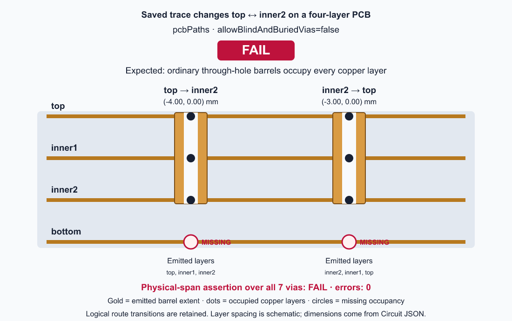
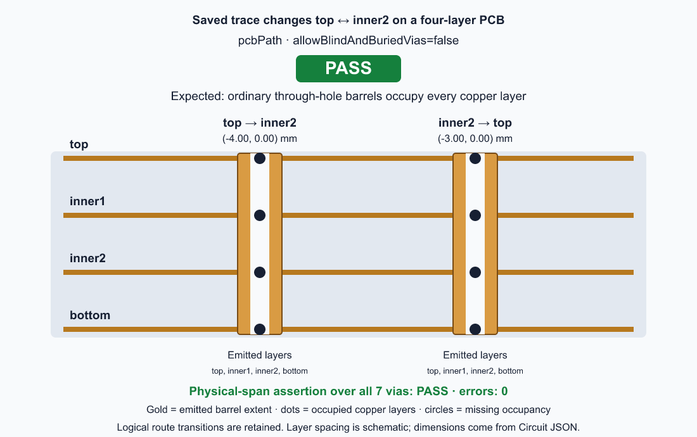
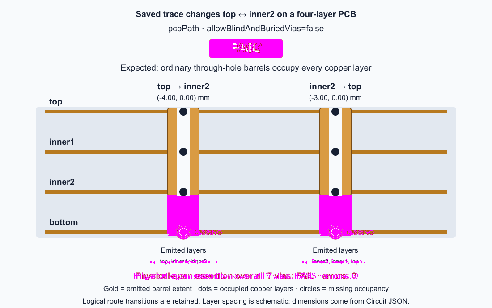

# Manual saved-path via physical span (#4526)

Related issue: https://github.com/tscircuit/core/issues/4526
Reproduction PR: https://github.com/tscircuit/core/pull/4528
Fix PR: https://github.com/tscircuit/core/pull/4529 (initial base: reproduction branch)

The signal uses `top → inner2 → top` on a four-layer PCB. With blind/buried
vias disabled, ordinary drilled barrels must occupy `top`, `inner1`, `inner2`,
and `bottom`. Logical `from_layer` / `to_layer` fields describe the signal
transition; they do not limit the physical barrel's `layers`.

## Reproduction PR (intentionally failing)

Upstream source commit: `afc31cf3ff71deba0c30e4365923544608b93094`.
On branch `repro/4526-manual-via-physical-span`, run with Bun 1.3.14,
without dependency patches:

```sh
bun install
VIA_SPAN_EVIDENCE_DIR=docs/issue4526/failing bun test tests/repros/repro4526-manual-via-physical-span.test.tsx
# Expected exit 1: 10 pass, 8 fail. Save stdout/stderr as failing/bun-test.log.
bun run scripts/render-manual-via-span-evidence.ts docs/issue4526/failing
```

The parameterized regression covers both `pcbPath` and `pcbPaths`, 2-, 4-,
and 10-layer stacks, and omitted/false/true `allowBlindAndBuriedVias`.
The paths exercise forward/reverse blind, buried, and outer-layer transitions.
Two-layer and blind/buried-enabled cases pass. The eight failing cases are
the multilayer omitted/false cases: physical occupancy omits required layers.
All cases first pass checks for no emitted errors, via counts/diameters,
logical transitions, and wire-layer preservation. Occupancy comparisons are
independent of array direction, so a reversed full-span via is a valid control.

## Actual-run visual evidence




These are annotated cross-sections derived from the actual emitted Circuit JSON,
not a proposed geometry. The first two of the seven emitted vias are shown.
The four copper layers, occupied-layer dots, barrel extent, logical transitions,
world coordinates, and missing bottom occupancy are visible. Layer spacing is
schematic; barrel/hole widths use emitted diameters. The header is centered.
FAIL/PASS is set only by the observed behavioral assertions, including setup.

`failing/observations.json` records all 18 cases and their expected/actual spans.
`failing/pcbPath.json` and `failing/pcbPaths.json` preserve the full emitted JSON
for the pictured cases. `failing/bun-test.log` records the actual assertion diffs.
`failing/environment.json` identifies the local dependency versions.

Failure artifacts live here, separate from expected snapshot baselines. The
test only compares a visual baseline after its behavioral assertions pass;
the reproduction PR contains no baseline captured from buggy output and no
implementation fix.

## Stack and merge order

The fix PR branches from this reproduction branch and initially targets it.
Review the reproduction first, then the isolated fix. Merge the reproduction,
retarget the fix to `main`, then merge the fix. The reproduction alone is
intentionally red; merge the pair together in that order.

## Fix PR

Both saved-path renderers now use the existing `getAutoroutedViaLayers` physical
policy helper with the containing board's `allowBlindAndBuriedVias` setting.
Omitted/false settings occupy the complete stack; true retains the logical
blind/buried span, including intermediate copper layers. Logical route points,
via endpoints, positions, dimensions, and connectivity identifiers are preserved.
No new span algorithm or runtime dependency is introduced.

The same 18 regression cases now pass (128 assertions). The 21 related tests
across 17 files also pass, including manual path snapshots, through-via
connectivity, explicit via spans, imported board policies, autorouted blind/buried
opt-in, and saved fanout paths. See `passing/related-test-files.txt` for the list.
All 18 cases retain identical non-span via geometry, and all six enabled cases
emit identical via records before and after the fix. Typechecking, the JavaScript
and declaration build, both distribution smoke checks, and Biome formatting/lint
checks pass. The new SVG baselines also match on a subsequent regression run.

On branch `fix/4526-manual-via-physical-span`:

```sh
VIA_SPAN_EVIDENCE_DIR=docs/issue4526/passing bun test tests/repros/repro4526-manual-via-physical-span.test.tsx
# Exit 0: 18 pass, 0 fail. Save stdout/stderr as passing/bun-test.log.
bun run scripts/render-manual-via-span-evidence.ts docs/issue4526/passing docs/issue4526/failing
```






The passing full Circuit JSON, matrix observations, and test logs are stored in
`passing/`. The expected SVG baselines under `tests/repros/__snapshots__/` were
first captured after all behavioral assertions passed; failure evidence remains
unchanged in `failing/`. Both APIs' images and their generated diffs were inspected.
